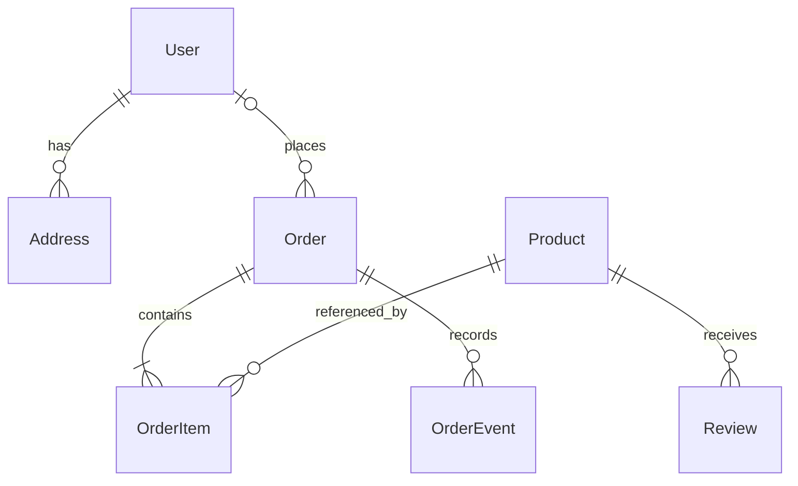

# Lumiere

**Katalog furnitur dan pemesanan yang terhubung dengan pemilik toko.** Lumiere adalah proyek portofolio full stack untuk membantu pelanggan menemukan furnitur, menyimpan pilihan, dan mengajukan pesanan. Pemilik toko mengelola katalog serta mengirim penawaran pengiriman sebelum pelanggan menyetujui pesanan.

[Coba aplikasi](https://lumiere-furniture-khaki.vercel.app/) · [Lihat kode](https://github.com/ainsalimah/lumiere)

## Masalah

Memilih furnitur tidak berhenti pada melihat foto dan harga. Pelanggan perlu membandingkan produk, memilih warna, dan memastikan pengiriman ke alamat tujuan. Pemilik toko perlu memeriksa ketersediaan, biaya kirim, dan estimasi pengiriman sebelum memproses pesanan.

Jika percakapan tersebut terpisah dari daftar barang yang dipesan, rincian harga dan kesepakatan mudah berbeda antara pelanggan dan pemilik.

## Solusi yang dibangun

Lumiere menghubungkan pengalaman menjelajahi katalog dengan ruang kerja pemilik. Permintaan pelanggan menjadi dasar penawaran, lalu pelanggan meninjau rincian tersebut sebelum pesanan masuk tahap pemrosesan.

- **Katalog yang mudah dijelajahi.** Cari produk, gunakan filter kategori, lihat detail dan ulasan, lalu pilih warna yang tersedia.
- **Pilihan tersimpan di perangkat.** Wishlist dan keranjang membantu pelanggan mengumpulkan pilihan. Keranjang menyesuaikan harga dan ketersediaan dengan katalog terbaru.
- **Penawaran yang disetujui pelanggan.** Pemilik menentukan biaya kirim, estimasi pengiriman, dan catatan. Pelanggan dapat menerima atau menolak penawaran yang ditampilkan.
- **Pesanan dengan riwayat.** Rincian produk dan harga disalin saat permintaan dibuat. Perubahan katalog sesudahnya tidak mengubah rincian pesanan baru yang sudah tersimpan.
- **Ruang kerja pemilik.** Kelola produk, lihat pelanggan dan pesanan, kirim penawaran, catat pembayaran manual, serta perbarui status pengiriman.

## Coba demo

Buka **[lumiere-furniture-khaki.vercel.app](https://lumiere-furniture-khaki.vercel.app/)** untuk menjelajahi katalog tanpa masuk. Untuk mengajukan pesanan dan melihat riwayatnya, daftar atau masuk melalui halaman akun. Google sign-in tersedia jika OAuth sudah dikonfigurasi.

Lumiere menggunakan katalog contoh untuk portofolio. Versi ini tidak membuat ruang demo pribadi untuk setiap pengunjung. Akses pemilik ditentukan oleh akun dengan email yang sesuai `OWNER_EMAIL`; kredensial pemilik tidak dipublikasikan.

| Pengguna | Yang dapat dilihat | Tindakan utama |
| --- | --- | --- |
| Pengunjung | Beranda, katalog, kategori, detail produk, dan ulasan | Cari produk, simpan wishlist, dan isi keranjang |
| Pelanggan | Profil, alamat, penawaran, dan riwayat pesanan sendiri | Ajukan pesanan, tanggapi penawaran, dan ikuti status |
| Pemilik | Katalog, pelanggan, dan daftar pesanan toko | Kelola produk, kirim penawaran, catat pembayaran, dan perbarui pengiriman |

**Alur singkat untuk mencoba:** buka **Shop**, pilih produk dan warna, lalu tambahkan ke keranjang. Masuk sebagai pelanggan dan kirim permintaan dengan alamat serta kontak penerima. Sesudah pemilik mengirim penawaran, buka pesanan di halaman akun untuk memeriksa biaya kirim dan estimasinya sebelum menerima atau menolak.

Fitur yang dijelaskan mengikuti kode pada branch ini. Deployment publik perlu diperbarui setelah migrasi database diterapkan untuk menggunakan alur terbaru.

## Cara kerja

1. Pelanggan mengirim permintaan pesanan. API menghitung harga dari katalog dan memeriksa ketersediaan serta warna. Total yang dikirim browser tidak dipercaya.
2. Pesanan menyimpan nama, gambar, harga item, jumlah, warna, dan nomor penerima saat dibuat. Kontak penerima tidak menimpa nomor telepon profil pelanggan.
3. Pemilik mengirim penawaran berisi biaya kirim, estimasi pengiriman, dan catatan. Pesanan tetap menunggu konfirmasi pelanggan.
4. Pelanggan menanggapi versi penawaran yang dilihatnya. Jika penawaran sudah berubah, API menolak tanggapan lama agar pelanggan meninjau rincian terbaru.
5. Persetujuan pelanggan mengubah status menjadi **Diproses**. Pemilik tidak dapat melewati persetujuan ini dengan tombol status.
6. Pembayaran dilakukan di luar aplikasi. Setelah persetujuan, pemilik dapat mencatat pembayaran penuh yang benar-benar diterima beserta metode dan catatannya.
7. Pemilik menandai pesanan **Dikirim** dan **Selesai**. Perubahan pesanan dan riwayat disimpan dalam transaksi dengan pemeriksaan versi agar perubahan bersamaan tidak saling menimpa.

| Status di antarmuka | Nilai di API | Makna |
| --- | --- | --- |
| Menunggu konfirmasi | `Accepted` | Permintaan masuk; belum disetujui pelanggan |
| Diproses | `Processing` | Pelanggan sudah menerima penawaran |
| Dikirim | `On the Way` | Pemilik menandai pengiriman |
| Selesai | `Delivered` | Pemilik menandai pesanan diterima |
| Dibatalkan | `Cancelled` | Permintaan dibatalkan atau penawaran ditolak |

## Keputusan teknis

| Area | Implementasi |
| --- | --- |
| Antarmuka | Next.js 15 App Router, React 19, TypeScript, dan Tailwind CSS 4 |
| API | Route Handlers Next.js, lapisan service, REST API, dan validasi Zod |
| Data | PostgreSQL, Prisma ORM, dan koneksi Neon |
| Autentikasi | JWT melalui header `Authorization: Bearer`, bcryptjs, dan verifikasi Google sign-in |
| Akses | Identitas dari token; alamat dan pesanan dibatasi ke pelanggan pemiliknya; akses pemilik mengikuti `OWNER_EMAIL` |
| Konsistensi pesanan | Transaksi database, pemeriksaan versi perubahan, dan riwayat `OrderEvent` |
| Harga historis | Snapshot produk dan harga pada `OrderItem`; total dihitung server |
| Email | Nodemailer untuk reset password ketika SMTP dikonfigurasi |

## Pengujian

- `npm test` memeriksa autentikasi pemilik, pengelolaan produk, harga dan varian pesanan, aturan status, akses API, serta batas akses ulasan.
- `npx tsc --noEmit` memeriksa tipe TypeScript; `npm run build` memeriksa build produksi.
- `node scripts/local-review.cjs --test-only` memeriksa migrasi dan alur service pada PostgreSQL lokal: kepemilikan alamat, perubahan alamat default bersamaan, penawaran lama, perubahan status bersamaan, snapshot pesanan, pembayaran manual, dan pengiriman.
- `node scripts/local-review.cjs --production` menjalankan regresi database dan membuka hasil build di `http://localhost:4180`. Jalankan `node scripts/http-review.cjs` dari terminal lain untuk memeriksa 25 permintaan HTTP sebagai pelanggan, pemilik, dan pengguna tanpa sesi.

Skrip regresi memakai cluster khusus di `.tmp-review-postgres` pada localhost:55432 dengan schema `public`. Koneksi lokal diatur oleh skrip; kredensial database dari `.env` tidak dibaca. Data pengujian di schema tersebut direset setiap kali dijalankan. PostgreSQL lokal diperlukan; path bawaan adalah `C:/Program Files/PostgreSQL/18/bin` dan dapat diubah melalui `PG_BIN`.

## Jalankan lokal

1. Siapkan Node.js yang mendukung Next.js 15 dan database PostgreSQL khusus pengembangan.
2. Salin `.env.local.example` ke `.env.local`. Isi `DATABASE_URL`, `DIRECT_URL`, dan `JWT_SECRET` dengan konfigurasi sendiri. Untuk PostgreSQL lokal, kedua URL boleh sama.
3. Isi `OWNER_EMAIL` untuk menentukan akun pemilik, lalu siapkan OAuth dan masuk melalui Google dengan email tersebut. Login email/password dan pendaftaran publik tidak tersedia untuk identitas pemilik.
4. Jalankan `npm install` dan `npx prisma generate`.
5. Untuk database pengembangan **baru dan kosong**, jalankan `npx prisma db push`. Untuk database yang sudah berisi data versi sebelumnya, ikuti bagian **Pembaruan database**.
6. Jalankan `npm run dev`, lalu buka `http://localhost:3000`.

Database kosong tidak otomatis memperoleh katalog. Tambahkan produk melalui ruang kerja pemilik atau gunakan preview katalog terpisah di bawah.

| Variabel lingkungan | Kegunaan |
| --- | --- |
| `DATABASE_URL` | Koneksi PostgreSQL aplikasi |
| `DIRECT_URL` | Koneksi langsung untuk operasi schema Prisma; menunjuk database yang sama |
| `JWT_SECRET` | Kunci sesi; gunakan nilai acak yang panjang |
| `OWNER_EMAIL` | Email akun yang diizinkan mengakses ruang kerja pemilik |
| `GOOGLE_CLIENT_ID`, `NEXT_PUBLIC_GOOGLE_CLIENT_ID` | Client ID Google untuk server dan antarmuka sign-in |
| `NEXT_PUBLIC_SITE_URL` | URL aplikasi untuk tautan reset password |
| `SMTP_HOST`, `SMTP_PORT`, `SMTP_USER`, `SMTP_PASS`, `SMTP_FROM` | Konfigurasi email |
| `ALLOW_DEMO_SEED` | Opt-in data demo lama; hanya aktif jika bernilai `true` di development |

Simpan kredensial di file lingkungan lokal dan jangan commit file tersebut. Google sign-in dan email membutuhkan konfigurasi penyedianya; keduanya bukan syarat untuk menjelajahi katalog.

Untuk memeriksa proyek: `npm test`, `npx tsc --noEmit`, dan `npm run build`. Untuk menjalankan hasil build, gunakan `npm start`.

## Preview katalog asli

Jika file lingkungan lokal menunjuk database katalog yang ingin ditampilkan, jalankan:

```powershell
npm run build
node scripts/catalog-preview.cjs
```

Buka `http://localhost:4180/shop`. Skrip membaca produk dan ulasan publik melalui transaksi **read-only**, lalu menyalinnya ke schema `catalog_preview` pada cluster PostgreSQL lokal yang sama. Database sumber tidak diubah. Akun dan pesanan sumber tidak disalin.

Preview ini terpisah dari data regresi, sehingga katalog tidak digantikan produk pengujian. Akun dan pesanan yang dibuat saat mencoba preview hanya berada di database lokal. Kedua server preview memakai port 4180; jalankan satu pada satu waktu.

## Aturan bisnis dan batasan

- Proyek ini mengelola satu toko dengan satu identitas pemilik yang dikonfigurasi. Belum ada ruang toko terpisah atau tim dengan beberapa peran.
- Wishlist dan keranjang disimpan melalui `localStorage`; belum tersinkron antarperangkat.
- Ketersediaan berupa flag `inStock`. Belum ada jumlah stok, reservasi, atau pengurangan stok otomatis per pesanan.
- Penawaran wajib disetujui sebelum pemrosesan. Persetujuan versi lama menghasilkan konflik `409` dan memerlukan pembacaan ulang.
- Pelanggan hanya dapat membatalkan pesanan yang masih menunggu konfirmasi. Pemilik dapat membatalkan sebelum pengiriman sesuai aturan status, selama pembayaran belum tercatat.
- Pembayaran penuh dicatat manual setelah persetujuan. Aplikasi tidak menarik dana atau menangani payment gateway, cicilan, dan refund. Pencatatan pembayaran ganda ditolak; pesanan yang pembayarannya sudah tercatat tidak dapat dibatalkan melalui tombol status.
- Invoice merupakan rincian pesanan, bukan bukti pembayaran otomatis. Pengiriman ditandai pemilik dan belum terhubung pelacakan kurir.
- Pesanan selesai atau dibatalkan tidak dapat dibuka kembali. Riwayat menyimpan waktu tindakan yang tercatat.
- Snapshot lengkap berlaku untuk pesanan baru. Harga item pesanan lama tidak dapat direkonstruksi; nama dan gambar yang diisi dari katalog saat migrasi dapat berbeda dari kondisi saat pemesanan.
- Rekomendasi AI tidak termasuk kemampuan aktif yang dijelaskan proyek ini.

## Struktur data



`OrderItem` menyimpan snapshot produk dan harga. `OrderEvent` menyimpan riwayat tindakan. `Review.orderId` menghubungkan ulasan secara logis ke pesanan; schema saat ini tidak mendefinisikan foreign key ulasan ke pesanan.

## REST API

Semua endpoint di bawah memakai prefix `/api`. Katalog dan ulasan produk dapat dibaca tanpa login. Endpoint akun dan pesanan membutuhkan token; pengelolaan toko membutuhkan identitas pemilik.

| Metode | Endpoint | Keterangan |
| --- | --- | --- |
| POST | `/register`, `/login`, `/google` | Pendaftaran pelanggan dan autentikasi |
| GET | `/session` | Periksa identitas sesi |
| POST | `/forgot-password`, `/reset-password` | Permintaan dan penggantian password |
| GET / POST | `/products` | Katalog publik atau tambah produk oleh pemilik |
| GET / PUT / DELETE | `/products/:id` | Detail publik atau ubah dan hapus produk oleh pemilik |
| GET / POST | `/products/:id/reviews`, `/reviews` | Baca ulasan atau kirim ulasan sesuai pesanan pelanggan |
| PUT | `/users/:id/profile`, `/users/:id/password` | Perbarui profil dan password sendiri |
| GET / POST | `/users/:id/addresses` | Baca dan tambah alamat sendiri |
| PUT / DELETE | `/users/:id/addresses/:addressId` | Ubah dan hapus alamat sendiri |
| POST / GET | `/orders` | Buat permintaan pelanggan atau daftar pesanan untuk pemilik |
| GET | `/users/:id/orders` | Riwayat pesanan pelanggan sendiri |
| PUT | `/orders/:id/offer` | Pemilik mengirim atau mengubah penawaran |
| PUT | `/orders/:id/offer-response` | Pelanggan menerima atau menolak dengan `expectedVersion` |
| PUT | `/orders/:id/cancel` | Pembatalan sesuai kepemilikan dan status |
| PUT | `/orders/:id/payment` | Pemilik mencatat pembayaran penuh dengan `expectedVersion` |
| PUT | `/orders/:id/status` | Pemilik memperbarui status pengiriman |
| GET | `/customers` | Daftar pelanggan untuk pemilik |
| GET | `/health` | Pemeriksaan kesehatan aplikasi |

## Pembaruan database

Untuk database versi sebelumnya, cadangkan data lalu terapkan [`prisma/upgrades/20261011_order_integrity.sql`](prisma/upgrades/20261011_order_integrity.sql) **sekali** melalui SQL client. File ini menjalankan perubahan dalam transaksi: menambah versi pesanan, snapshot item, kontak penerima, informasi pembayaran manual, dan tabel riwayat.

Upgrade mempertahankan produk serta pesanan yang sudah ada. Nama dan gambar item lama diisi dari katalog saat migrasi; harga historis yang tidak tersedia tetap kosong. Riwayat awal menggunakan waktu permintaan dibuat dan tidak mengarang waktu tahapan selanjutnya.

Jalankan `npx prisma generate` untuk menyesuaikan client lokal. Terapkan migrasi sebelum menjalankan kode baru pada database lama. Jangan gunakan `db push` terhadap database produksi yang sudah berisi data.

Aset di `public/` disimpan sebagai file Git biasa agar gambar tersedia pada checkout untuk build. Jika checkout lama masih memakai Git LFS, pastikan gambar sudah diunduh lalu jalankan `git add --renormalize public` dan periksa bahwa file yang akan di-commit merupakan gambar asli, bukan pointer LFS.
